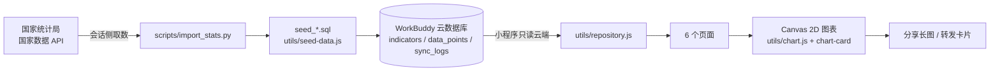
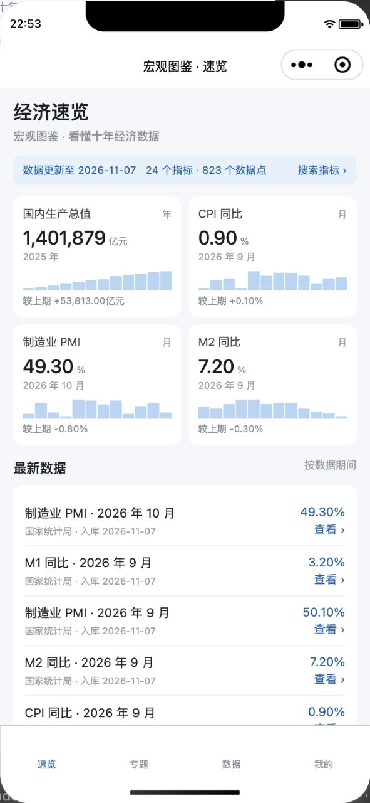
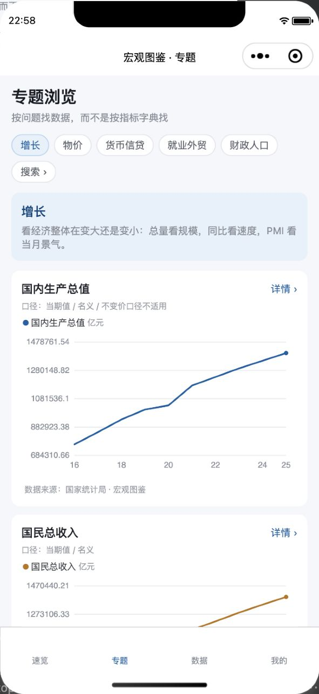
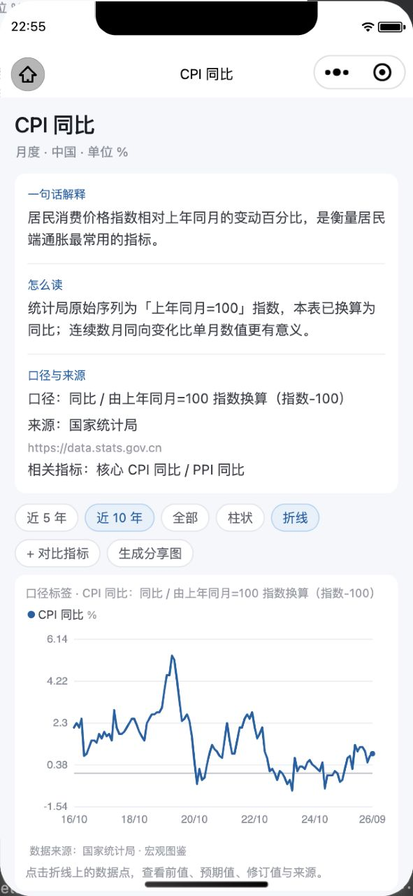
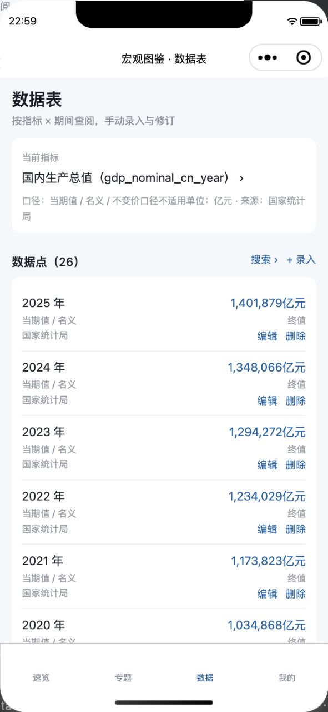
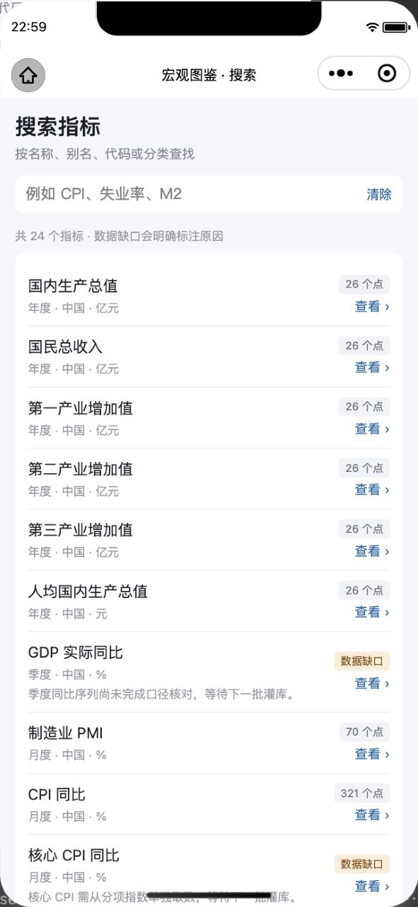
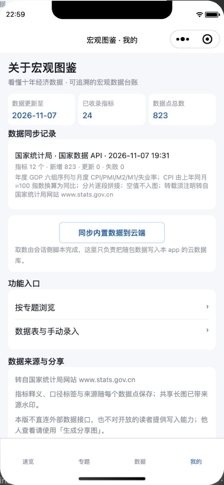

<div align="center">
  
  <h1>宏观图鉴</h1>
  <p><strong>看懂十年经济数据</strong> · 一本可读的宏观经济数据台账与图表读物</p>
  <p>
    
    
    
    
  </p>
</div>


> 动图循环展示：封面 → 速览 → 专题 → 指标详情 → 数据表 → 搜索 → 我的，共 7 帧、约 14 秒（480 × 1040）。静态截图见文末「页面一览」。

## 这是什么

一个**原生微信小程序**，把历年宏观经济数据整理成可查、可读、可分享的图表台账。它解决的问题不是「更快地看到一条快讯」，而是「把一条指标放回十年的时间尺度里，看懂它的口径、位置和变化」。

- **是**：数据读物 / 口径说明 / 趋势图表 / 可追溯的台账
- **不是**：实时行情终端、资讯流、投资决策工具，也不提供任何预测或建议
- 设计参照了财经日历类产品对 `前值 / 预期 / 修订值 / 重要度 / 发布日期` 的表达方式，但把重心放在**历史序列 + 口径解释**上

## 功能一览

| 页面 | 路径 | 主要内容 |
| --- | --- | --- |
| **速览** | `pages/index/index` | 4 张重点指标卡（GDP、CPI、制造业 PMI、M2）、迷你趋势柱、最新数据流水、数据总量与更新时间 |
| **专题** | `pages/topics/topics` | 按「增长 / 物价 / 货币信贷 / 就业外贸 / 财政人口」5 类组织，先给解读再给图表 |
| **指标详情** | `pages/detail/detail` | 一句话解释、怎么读、口径与来源、近 5 / 10 年与全部区间、折线 / 柱状切换、双指标对比、点选数据点、生成分享长图 |
| **数据表** | `pages/data/data` | 按指标 × 期间查阅数据点，支持手动录入、编辑、删除与修订标记 |
| **搜索** | `pages/search/search` | 按名称、别名、代码检索 24 个指标，数据缺口会直接标注原因 |
| **我的** | `pages/mine/mine` | 数据总量、同步日志、内置数据同步入口、功能入口、数据来源与分享说明 |

## 数据说明

| 项 | 值 |
| --- | --- |
| 指标数 | **24** |
| 真实数据点 | **823** |
| 取数批次 | `stats-20261107` |
| 一手来源 | 国家统计局「国家数据」公开接口 `https://data.stats.gov.cn` |
| 转载署名 | `转自国家统计局网站 www.stats.gov.cn` |

几条坚持的原则：

1. **不编造数值**。取不到的指标（海外序列、核心 CPI、PPI 分行业、季度 GDP 同比、社融、LPR 等）保留在指标字典里，界面明确显示「数据缺口」及原因，图上留空而不是补点。
2. **口径优先**。CPI 原始序列是「上年同月 = 100」指数，脚本换算为同比；每条数据点带 `口径 / 单位 / 来源 / 修订状态 / 发布日期`。
3. **防跨口径误读**。`comparable_group` 是「口径 + 单位」签名，不同分组默认禁止叠加对比。
4. **来源可追溯**。图表与分享长图都带来源水印，指标释义、口径标签与来源随数据点一起保存。

## 技术架构



| 层 | 选型 | 说明 |
| --- | --- | --- |
| 前端 | 原生微信小程序（WXML / WXSS / JS） | 无跨端框架，`lazyCodeLoading: requiredComponents` |
| 图表 | 自绘 Canvas 2D | 折线 / 柱状、双轴、零轴、空值跳过、点击命中区、来源水印、动态测量文字避免 Y 轴标签裁切 |
| 数据 | WorkBuddy 云服务（PostgreSQL + RLS） | `cloud.database.from(...)`，表：`indicators`、`data_points`、`dashboards`、`sync_logs` |
| 配置 | 环境变量 → 构建前生成 | `npm run setup` 把凭据写成本地私有文件，仓库只保留占位模板与加载器 |
| 取数 | 会话侧 Python 脚本 | 小程序**不直连**外部 API，规避 request 合法域名与备案限制；产物以只读种子包随代码分发，首次启动写入自己的云数据库 |
| 分享 | `canvasToTempFilePath` + `saveImageToPhotosAlbum` | 生成带来源水印的长图；6 个页面均定义了 `onShareAppMessage` 转发卡片 |

## 目录结构

```
macro-atlas/
├── app.js / app.json / app.wxss        # 全局配置、名称与副标题、视觉样式
├── pages/                              # 速览 / 专题 / 指标详情 / 数据表 / 搜索 / 我的
├── components/chart-card/              # Canvas 图表卡片（点击命中、导出长图）
├── utils/
│   ├── indicators.js                   # 指标字典、专题、释义、口径与可比分组
│   ├── repository.js                   # 云端读写封装（分页、排序、增删改）
│   ├── chart.js / viewmodel.js         # Canvas 绘制 / 页面视图模型
│   ├── format.js                       # 数值、期间、差值、迷你柱格式化
│   ├── cloud.js / public-config.js     # 云 SDK 初始化 / 本地配置加载器（无凭据）
│   ├── seed.js / seed-data.js          # 首次启动灌库逻辑 + 823 条真实种子数据
│   └── workbuddy-cloud-diagnostics.js  # 云请求诊断
├── scripts/
│   ├── import_stats.py                 # 会话侧取数与产物生成
│   ├── setup-local-config.js           # 环境变量 → 本地私有配置
│   ├── check-secrets.js                # 提交前凭据自检
│   └── seed_indicators.sql / seed_points.sql / seed_sync.sql
├── docs/                               # README 演示动图、静态截图、头像
├── miniprogram_npm/                    # 构建 npm 生成的云 SDK 小程序包
├── .env.example                        # 环境变量占位模板（唯一可提交的配置样例）
└── .gitignore                          # 排除密钥、生成文件与开发产物
```

> `docs/`、`scripts/`、`README.md`、`node_modules/`、`.workbuddy/`、`.env*`、`project.private.config.json` 已在 `project.config.json` 的 `packOptions.ignore` 中排除，不会进入小程序代码包。

## 本地运行

> **凭据不进仓库**：AppID、云服务 endpoint / publishableKey / OAuth clientId 一律从**环境变量**读取。小程序运行时没有 `process.env`，JSON 配置也无法读环境变量，因此采用「构建前生成」：`npm run setup` 把环境变量写成本地私有文件（均已 gitignore）。直接导入而不执行这一步，编译会明确提示「缺少本地配置」。

1. **克隆**
   ```bash
   git clone git@github.com:eelisteng/macro-atlas.git
   cd macro-atlas
   ```

2. **填写环境变量并生成本地配置**（必做）
   ```bash
   cp .env.example .env.local
   # 编辑 .env.local，填入 4 个值
   npm run setup
   ```
   CI / 云端构建可直接 `export` 同名变量再执行 `npm run setup`；显式环境变量优先于 `.env.local`。

   | 变量 | 来源 |
   | --- | --- |
   | `WX_APPID` | mp.weixin.qq.com → 开发管理 → 开发设置 → 开发者 ID → AppID |
   | `WB_CLOUD_ENDPOINT` | WorkBuddy 云服务激活后的 `publicConfig.endpoint`，`https://` 开头、不带路径 |
   | `WB_PUBLISHABLE_KEY` | 同上，`publicConfig.publishableKey` |
   | `WB_OAUTH_CLIENT_ID` | 同上，`publicConfig.workBuddyOAuthClientId` |

   `npm run setup` 生成两个文件，都已加入 `.gitignore`：
   - `utils/local-env.js` — 运行时值，由 `utils/public-config.js` 加载，会随小程序代码包发布（前端 publishable key 本就如此）
   - `project.private.config.json` — 真实 AppID + `urlCheck: false`，按微信官方规则覆盖 `project.config.json` 里的占位 `touristappid`

3. **构建 npm**
   ```bash
   npm install
   ```
   然后在开发者工具里执行「工具 → 构建 npm」，生成 `miniprogram_npm/`。仓库已包含构建产物，可跳过此步直接编译。注意 `@tencent-ai/workbuddy-cloud-sdk` 由 WorkBuddy 平台提供（`dev` 版本）；若要在非 WorkBuddy 环境复现，需要把 `utils/cloud.js` + `utils/repository.js` 换成自己的数据访问层。

4. **导入开发者工具并配置云服务**
   - 用「微信开发者工具」→ 导入项目 → 选择该目录；AppID 会自动从 `project.private.config.json` 读取，无需手工填写。
   - 在云数据库中建好 `indicators`、`data_points`、`sync_logs`、`dashboards` 四张表；可用 `scripts/seed_*.sql` 初始化，或直接让小程序首次启动执行 `ensureSeeded()`。
   - 首次启动若发现 `data_points` 为空，「速览」页会自动把随包的 823 条真实数据写入云端；也可在「我的 → 同步内置数据到云端」手动触发。

5. **配置服务器域名**（真机必须）
   在 mp.weixin.qq.com → 开发 → 开发设置 → **request 合法域名** 添加 `WB_CLOUD_ENDPOINT` 对应的域名（只到域名、不带路径与端口）。`project.private.config.json` 里的 `urlCheck: false` **只在模拟器 / 调试模式生效**，正式版会强制校验合法域名。

## 配置与密钥安全

- 受版本控制的文件里**不含**任何真实 AppID 或云凭据；`project.config.json` 的 `appid` 是官方占位值 `touristappid`，`utils/public-config.js` 只是加载器。
- `.env` / `.env.local`、生成文件 `project.private.config.json` / `utils/local-env.js`、以及 `.workbuddy/`、`node_modules/`、`.wbapp_*.privacy.json` 全部在 `.gitignore` 中，并已从版本库移除（本地磁盘仍保留）。
- `.env.local` 也已加入 `packOptions.ignore`，避免被一起打进小程序代码包；但 `utils/local-env.js` **必须**留在包里，否则运行时拿不到配置。
- 提交前执行 `npm run check:secrets`：扫描受版本控制的文本文件里是否又混入凭据，并校验私有文件确实被忽略。第三方 SDK 打包产物内含厂商自身的 OAuth AppID 常量，属 SDK 自带，检查脚本会跳过 vendor 目录。
- 云端构建需在构建环境注入同名环境变量、并在编译前执行 `npm run setup`；不要把 `.env.local` 上传到任何托管服务。
- 仓库历史已重写为单个干净提交，当前所有提交均不含凭据。但这些值曾在公开仓库中出现过，**建议在 WorkBuddy 控制台轮换 publishableKey**——只有轮换能让泄露过的旧值彻底失效。

## 更新数据

```bash
python3 scripts/import_stats.py
```

脚本在本机会话中访问国家统计局公开接口，输出三份 SQL 和 `utils/seed-data.js`（请勿手工编辑生成文件）。随后重新编译小程序，在「我的」页执行「同步内置数据到云端」即可刷新云端序列。刷新前请确认 `BATCH` 批次号与来源说明一致。

## 图表与分享

- 折线 / 柱状切换、近 5 年 / 10 年 / 全部区间、同口径双指标对比、点击折线上的数据点查看前值 / 预期值 / 修订值与来源。
- 「生成分享图」把当前图表导出为带来源水印的长图保存到相册，图片可直接发微信好友或朋友圈，不受小程序发布状态限制。
- 6 个页面都已定义 `onShareAppMessage`；详情页转发会带上指标 `code`，对方打开后直达该指标。

## 页面一览

| 速览 | 专题 |
| --- | --- |
|  |  |
| **指标详情** | **数据表** |
|  |  |
| **搜索** | **我的** |
|  |  |

## 当前状态与已知限制

- 小程序处于**开发中 / 上架准备**阶段：名称、头像、服务类目、ICP 备案、代码提审与正式发布仍在进行，当前仅能通过开发者预览或体验版访问。
- **安全待办**：云数据库 RLS 目前对匿名开放写权限，正式向外部读者开放前必须收紧为「公开读、仅本人写」；泄露过的 publishableKey 待在 WorkBuddy 控制台轮换。
- 海外数据、核心 CPI、PPI、季度 GDP 同比等仍是明确标注的数据缺口；`dashboards` 表已建但看板管理尚未开放。
- 未实现实时推送、财经日历、预警与离线只读兜底；未启用「分享到朋友圈」（单页模式下 Canvas 图表不可靠）。

## 数据来源与合规

全部数值来自国家统计局「国家数据」公开接口，转载须注明 **「转自国家统计局网站 www.stats.gov.cn」**。指标释义与「怎么读」为项目自行撰写，仅供学习查阅，不构成任何投资建议。小程序上线前须按工信部要求完成小程序备案。

**授权**：代码授权尚未指定；数据版权归国家统计局所有。
